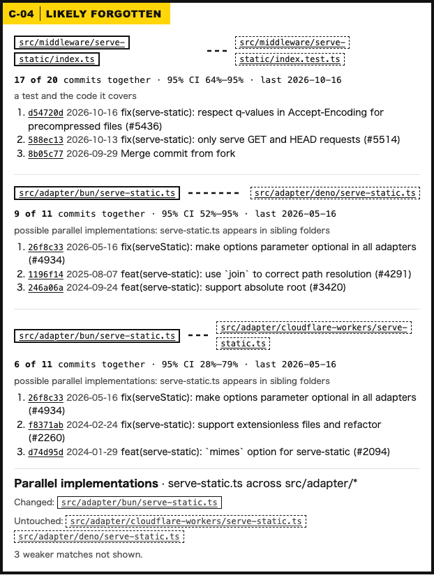
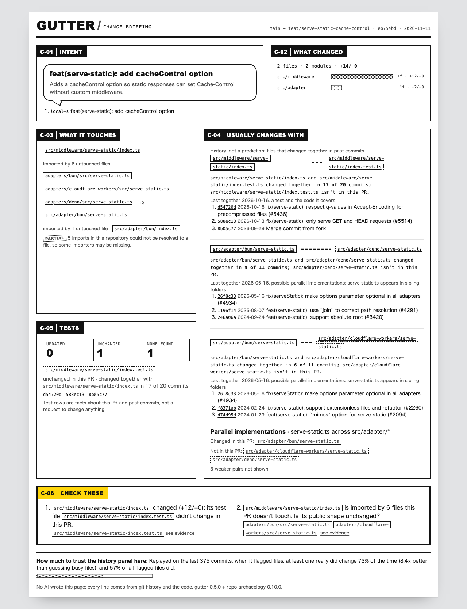

# <picture><source media="(prefers-color-scheme: dark)" srcset="docs/brand/icon-dark.svg"></picture> Gutter

**Understand a pull request before you review it.**

Gutter is a GitHub Action and CLI (`gutter-brief`, binary `gutter`) that posts a compact, evidence-backed change briefing on every pull request — what changed, what depends on it, and which historically related files deserve another look — with clickable commit receipts.

`Experimental · v0.1.0` · `Local-first` · `Deterministic (no AI / LLM)` · `MIT License`

```yaml
# .github/workflows/gutter.yml
name: Gutter
on:
  pull_request:
    types: [opened, synchronize, reopened, ready_for_review]
permissions:
  contents: read
  pull-requests: write
jobs:
  brief:
    if: ${{ !github.event.pull_request.draft }}
    runs-on: ubuntu-24.04
    steps:
      - uses: actions/checkout@v6
        with:
          ref: ${{ github.event.pull_request.head.sha }}
          fetch-depth: 0
      - uses: actions/setup-node@v6
        with:
          node-version: 22
      - uses: lbrodie11/gutter@v0
```

> **Pre-release status:** The `v0.1.0` / `v0` release tags and the `gutter-brief` npm package are published by [`.github/workflows/release.yml`](.github/workflows/release.yml) once the initial release tag is pushed and the repository is made public (see [`docs/RELEASING.md`](docs/RELEASING.md)). Until `v0.1.0` is cut, use [Option 1 (Run locally from source)](#option-1--run-locally-from-source-works-today) below.

---

### See what the diff doesn't tell you

Gutter combines `git diff` structure, static import analysis, test-file conventions, and [Repo Archaeology](https://github.com/lbrodie11/repo-archaeology) co-change history into a compact, evidence-backed briefing for human reviewers.

**Gutter doesn't replace your judgment.** It never writes AI verdicts, suggests code rewrites, or blocks a merge. Instead, it gives you verifiable repository evidence — with clickable commit receipts, 95% Wilson confidence intervals, and a per-repo accuracy backtest — so you can decide where to spend your attention.



<sub>Above: Panel 4 of Gutter's briefing on an illustrative [honojs/hono](https://github.com/honojs/hono) change. Touching `src/middleware/serve-static/index.ts` and `src/adapter/bun/serve-static.ts` surfaces the untouched middleware test (`17 of 20` commits together) and sibling Deno adapter (`9 of 11` commits together), with the exact commits behind each relationship.</sub>

---

## Example: Spotting overlooked relationships in Hono

> **About this example:** Below is an illustrative branch on [honojs/hono](https://github.com/honojs/hono) (based on commit [`eb754bd`](https://github.com/honojs/hono/commit/eb754bd5ef22c63f1634a4c374a86be086f85710)) analyzed against Hono's real commit history (`1,868` commits). The proposed `cacheControl` edit is a local simulation, not an existing Hono pull request; all co-change counts, confidence intervals, and supporting commit receipts are genuine.
>
> **Reproduce locally:**
> ```bash
> # Re-render the Markdown comment or HTML page from the saved contract:
> node dist/cli.js render docs/example/gutter.json --format md
> node dist/cli.js render docs/example/gutter.json --format html > /tmp/gutter.html
>
> # Or re-run the full analysis from scratch against a clone of honojs/hono:
> bash docs/example/reproduce.sh
> ```

### 1 · What Gutter surfaces

Suppose a pull request adds a `cacheControl` option to Hono's shared static-file middleware ([`src/middleware/serve-static/index.ts`](https://github.com/honojs/hono/blob/eb754bd5ef22c63f1634a4c374a86be086f85710/src/middleware/serve-static/index.ts)) and updates the Bun adapter ([`src/adapter/bun/serve-static.ts`](https://github.com/honojs/hono/blob/eb754bd5ef22c63f1634a4c374a86be086f85710/src/adapter/bun/serve-static.ts)), touching 2 files (+10/−0).

Before you read a line of the diff, Gutter raises three evidence-backed questions:

| Reviewer question | Historical / static evidence | Supporting receipts |
|---|---|---|
| Does [`src/middleware/serve-static/index.test.ts`](https://github.com/honojs/hono/blob/eb754bd5ef22c63f1634a4c374a86be086f85710/src/middleware/serve-static/index.test.ts) need a matching change? | Changed alongside `serve-static/index.ts` in **17 of its last 20 commits** (95% CI 64%–95%), untouched here | [`d54720d`](https://github.com/honojs/hono/commit/d54720da80134a180f5fe2dd98a7676cfc8f08b4) · [`588ec13`](https://github.com/honojs/hono/commit/588ec13fa68ea44fed1b5e1b503341db2bf09d70) · [`8b05c77`](https://github.com/honojs/hono/commit/8b05c774ef1555c70f5ba5e2991b7e77cc3635cc) |
| Does [`src/adapter/deno/serve-static.ts`](https://github.com/honojs/hono/blob/eb754bd5ef22c63f1634a4c374a86be086f85710/src/adapter/deno/serve-static.ts) need a matching change? | Changed alongside the Bun adapter in **9 of 11 commits** (95% CI 52%–95%), untouched here | [`26f8c33`](https://github.com/honojs/hono/commit/26f8c33f23e6151873d165107f2dbcadf1204d15) · [`1196f14`](https://github.com/honojs/hono/commit/1196f14b94e589e2ac44fa7f1c8785d70c1cf83e) · [`246a06a`](https://github.com/honojs/hono/commit/246a06aa1d35aa206dcf11186b3aa90badb2de72) |
| Should [`src/adapter/cloudflare-workers/serve-static.ts`](https://github.com/honojs/hono/blob/eb754bd5ef22c63f1634a4c374a86be086f85710/src/adapter/cloudflare-workers/serve-static.ts) (+1 more) follow? | PR changes **1 of 3 parallel implementations** (`serve-static.ts across src/adapter/*`) | [`cloudflare-workers/serve-static.ts`](https://github.com/honojs/hono/blob/eb754bd5ef22c63f1634a4c374a86be086f85710/src/adapter/cloudflare-workers/serve-static.ts) · [`deno/serve-static.ts`](https://github.com/honojs/hono/blob/eb754bd5ef22c63f1634a4c374a86be086f85710/src/adapter/deno/serve-static.ts) |

### 2 · What lands in the pull request (sticky Markdown comment)

GitHub pull request comments cannot render custom CSS, so Gutter posts **one compact, updating Markdown comment** (and stays completely silent on small, unremarkable PRs in `auto` mode). Full source: [`docs/example/brief.md`](docs/example/brief.md).

> ### Gutter · change briefing
>
> **feat(serve-static): add cacheControl option**: 2 files across 2 modules (+10/−0)
>
> **Worth a look**
>
> 1. `src/middleware/serve-static/index.test.ts` changed alongside `src/middleware/serve-static/index.ts` in 17 of its 20 commits (95% CI 64%–95%) but is untouched here. Does it need a matching change?<br><sub>receipts: [d54720d](https://github.com/honojs/hono/commit/d54720da80134a180f5fe2dd98a7676cfc8f08b4) · [588ec13](https://github.com/honojs/hono/commit/588ec13fa68ea44fed1b5e1b503341db2bf09d70)</sub>
> 2. `src/adapter/deno/serve-static.ts` changed alongside `src/adapter/bun/serve-static.ts` in 9 of its 11 commits (95% CI 52%–95%) but is untouched here. Does it need a matching change?<br><sub>receipts: [26f8c33](https://github.com/honojs/hono/commit/26f8c33f23e6151873d165107f2dbcadf1204d15) · [1196f14](https://github.com/honojs/hono/commit/1196f14b94e589e2ac44fa7f1c8785d70c1cf83e)</sub>
> 3. This changes 1 of 3 parallel implementations (serve-static.ts across src/adapter/\*). Should `src/adapter/cloudflare-workers/serve-static.ts` (+1 more) follow?<br><sub>receipts: [`src/adapter/cloudflare-workers/serve-static.ts`](https://github.com/honojs/hono/blob/eb754bd5ef22c63f1634a4c374a86be086f85710/src/adapter/cloudflare-workers/serve-static.ts) · [`src/adapter/deno/serve-static.ts`](https://github.com/honojs/hono/blob/eb754bd5ef22c63f1634a4c374a86be086f85710/src/adapter/deno/serve-static.ts)</sub>
>
> *(Plus collapsible `<details>` tables for **Likely forgotten**, **What it touches**, **Tests**, and **What changed**.)*
>
> <sub>Replayed on the last 375 commits: when it flagged files, at least one really did change 73% of the time (6.8× better than guessing busy files), and 57% of all flagged files did. · No AI wrote this: every line comes from git history and the code · gutter 0.1.0 + repo-archaeology 0.3.0</sub>

### 3 · The full six-panel page (`gutter.html` artifact)

Alongside the Markdown comment, Gutter writes a self-contained, offline HTML page ([`docs/example/gutter.html`](docs/example/gutter.html)) rendered in [FRAME/12](https://github.com/lbrodie11/frame12)'s comic panel grammar — uploaded as a workflow artifact in CI or opened locally from `.gutter/gutter.html`:



| Panel | Question it answers | Evidence source |
|---|---|---|
| **C-01 · Intent** | What is this change trying to do? | PR title/body, commit subjects |
| **C-02 · What changed** | How big is it, and where? | `git diff` grouped into modules, churn as screentone |
| **C-03 · What it touches** | Who depends on what changed? | Relative import scan for TS/JS; unresolved aliases or packages mark `dependents.coverage` as **`partial`** (with sample receipts), and other languages are reported as **`unchecked`** — never silently as "no dependents" |
| **C-04 · Likely forgotten** | Which files historically change with these files? | [Repo Archaeology](https://github.com/lbrodie11/repo-archaeology) directional co-change history with 95% Wilson intervals and commit receipts |
| **C-05 · Tests** | Did conventional test files move with the code? | Co-located, `__tests__/`, and mirrored `test/` / `tests/` convention links |
| **C-06 · Check these** | Where should I focus first? | Up to 4 deterministic questions, each required to cite evidence IDs from panels C-03 to C-05 |

Every generated HTML page is verified against 6 [FRAME/12](https://github.com/lbrodie11/frame12) design-grammar rules in `lintPage()` (`color-literal`, `gradient`, `font-literal`, `marker-misuse`, `illegal-gutter` restricting CSS `gap`/`row-gap`/`column-gap`/`grid-gap` to `0`/`12px`/`20px`/`32px` or `--f-gutter-*` tokens, and `cut-order` enforcing sequential `C-01`…`C-0N` panel labels).

---

## How accuracy calibration works (73% hit rate vs. 57% precision)

Historical co-change is a probabilistic signal, not proof of a bug. Sometimes a companion file was genuinely overlooked; other times a change intentionally applies to only one adapter or module.

To help reviewers calibrate trust on *their specific repository*, Gutter runs Repo Archaeology's walk-forward backtest on recent history and reports retrospective co-change prediction metrics (not the percentage of real-world omissions detected):

- **Evaluated window (`375` held-out test commits on Hono):** Each held-out commit is replayed using only history prior to that commit.
- **Query hit rate (`73%` across `516` fired file-level queries, `6.8×` lift over guessing busy files):** Among the `516` file-level queries where historical suggestions were returned, `73%` had at least one suggestion that genuinely changed in the same commit.
- **Per-suggestion precision (`57%`):** Across all individual file suggestions emitted across those queries, `57%` matched files that changed in the same commit.

**Automatic gating:** When a repository's measured per-suggestion precision falls below `25%`, Gutter suppresses co-change questions from the checklist while still keeping the raw table available for inspection. Weak matches (Wilson lower bound `< 30%`) and matches backed mostly by bot commits (`dependabot`, `renovate`, etc.) never become checklist questions.

---

## Quick start

### Option 1 · Run locally from source (works today)

Built `dist/` runs on **Node.js ≥ 22** (and `git`).

```bash
# 1. Clone and build Gutter
git clone https://github.com/lbrodie11/gutter.git /tmp/gutter
cd /tmp/gutter
npm ci
npm run build

# 2. Switch to the repository you want to analyze (on a feature branch)
cd /path/to/your-project
node /tmp/gutter/dist/cli.js brief --base main
# → .gutter/gutter.json   the evidence contract
#   .gutter/brief.md      the compact PR comment
#   .gutter/gutter.html   the self-contained six-panel page
```

### Option 2 · CLI (`gutter-brief` on npm, binary `gutter` — available after `v0.1.0` npm publish)

```bash
npx gutter-brief brief --base main
npx gutter-brief brief --base main --print md        # also print the Markdown comment to stdout
npx gutter-brief render .gutter/gutter.json --format html > page.html
```

Useful flags: `--title` / `--intent` (PR text), `--pr <n>`, `--ra-bin <path>` (use a local Repo Archaeology build), `--ra-diff` / `--ra-backtest` (use saved JSON), `--no-history`, `--no-calibration`. Run `gutter --help` for the full list.

### Option 3 · GitHub Action (`lbrodie11/gutter@v0` — available after `v0.1.0` tag push)

> **SHA-pinning note:** `dist/` is gitignored on `main` and attached to release tag commits by `release.yml`. If you pin actions to a 40-character commit SHA instead of `@v0` / `@v0.1.0`, always pin to the **release tag's commit SHA** (`git rev-parse v0.1.0^{commit}`), never an unbuilt `main` branch commit SHA.

| Input | Default | Behavior |
|---|---|---|
| `post` | `auto` | `auto` skips quiet PRs (but updates an existing sticky comment), `always`, or `never` (job summary + artifact only) |
| `history` | `true` | Run Repo Archaeology co-change analysis (`npx --yes repo-archaeology@^0.3.0`) |
| `calibrate` | `true` | Backtest warning accuracy on this repo (~0.3s on 1,900 commits) |
| `max-forgotten` | `3` | Maximum historical companions to display (`0` disables companion rows) |
| `archaeology-version` | `^0.3.0` | npm version range of `repo-archaeology` to execute |
| `upload-page` | `true` | Upload `gutter.html` and `gutter.json` as the `gutter-brief` workflow artifact |

Action outputs: `status` (`analyzed` / `skipped` / `error`), `salience` (`quiet` / `brief` / `full`), `question-count`, `forgotten-count`, `json-path`, `html-path`.

---

## Why the name "Gutter"?

In comics, the *gutter* is the space between panels where the reader connects two moments and works out what happened. Code review now lives there: coding agents and large refactors touch more files at once, while alphabetical file diffs fragment the story. Gutter lays out the space between the commits so a human reviewer can see the whole shape of a change before reading line by line.

## Principles

1. **Explain, don't judge.** Gutter asks questions ("Does it need a matching change?"), never verdicts. It never fails a build.
2. **Evidence before narration.** Every surface renders from one deterministic document, [`gutter.json`](schema/gutter.schema.json) (`schemaVersion: 1`). Every checklist item must cite evidence IDs that exist in that document; the renderers throw if any reference is missing. The contract evolves additively within `schemaVersion: 1`: **consumers must ignore unknown fields and tolerate unknown enum values** (for example, new `checklist.kind` or `dependents.coverage` values).
3. **Honest uncertainty.** Counts with denominators, 95% Wilson intervals, per-repo backtests, `partial` / `unchecked` notices instead of silent false negatives, and a badge when evidence comes mostly from bot commits.
4. **Nothing to say is success.** Small, unremarkable PRs get one quiet line or no comment at all.

## Architecture, Privacy & Dependencies

```
git diff ─────────────┐
git ls-files + imports ┤
test-file conventions ─┼─▶ evidence engine ─▶ gutter.json ─┬─▶ compact Markdown (PR comment)
repo-archaeology diff ─┤                      (contract)    └─▶ comic page (FRAME/12 HTML artifact)
repo-archaeology       ┘
  backtest
```

- **Privacy & data handling:** Analysis runs entirely on your local machine or your GitHub Actions runner. Gutter never transmits source code, diffs, or git history to any Gutter-operated service. When run in GitHub Actions, the Markdown comment (`post: auto|always`) and optional `gutter-brief` artifact (`upload-page: true`) are stored by GitHub in your repository's pull request and workflow run.
- **Dependencies:** `gutter-brief` has **zero direct runtime npm dependencies** (`package.json` `dependencies` is empty). When co-change history is enabled (the default), Gutter invokes [`repo-archaeology`](https://www.npmjs.com/package/repo-archaeology) via `npx --yes repo-archaeology@^0.3.0` (or a pre-installed binary via `--ra-bin` / `GUTTER_RA_BIN`). Pass `--no-history` (or `history: 'false'` in the Action) for a completely offline static run.
- **Security:** Designed for `pull_request`, **never `pull_request_target`**. All PR-derived text is escaped per output format; links are built only from `http(s)` base URLs and hex SHAs; git is invoked strictly with argument vectors. See [SECURITY.md](SECURITY.md) for the full threat model.

## Development

```bash
npm ci
npm test          # node:test (runs .ts sources directly on Node.js >= 22.6)
npm run typecheck
npm run build     # compiles dist/ (built CLI and Action run on Node.js >= 22 without experimental flags)
```

- **Runtime requirement (built `dist/`):** Node.js ≥ 22 (`engines.node: ">=22"`), zero runtime dependencies.
- **Development & test requirement:** Node.js ≥ 22.6 (TypeScript sources in `src/` and `test/` run directly via `--experimental-strip-types`).

## Documentation & Community

- [Architecture & Product Decisions (`docs/DECISIONS.md`)](docs/DECISIONS.md)
- [Release Checklist & Marketplace Guide (`docs/RELEASING.md`)](docs/RELEASING.md)
- [Validation Roadmap (`docs/ROADMAP.md`)](docs/ROADMAP.md)
- [JSON Schema (`schema/gutter.schema.json`)](schema/gutter.schema.json)
- [Contributing Guide (`CONTRIBUTING.md`)](CONTRIBUTING.md)
- [Security Policy (`SECURITY.md`)](SECURITY.md)

## License

[MIT](LICENSE) © Laqwan Brodie
